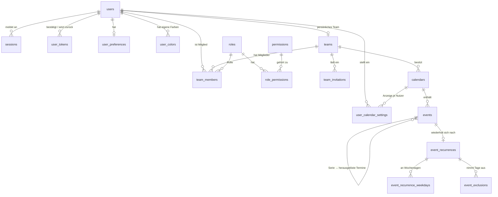

# Datenbank

**Eine Datenbank mit allen Tabellen** für Konten, Sitzungen, persönliche Kalender, Teams und Team-Kalender. Ziel sind **MySQL 8.0.16+** und **MariaDB 10.6+**. Die Tabellen sind in der **3. Normalform**. Getestet wurde mit MySQL 8.0.46 und MariaDB 10.11 (123 Prüffälle, dazu 19 für Migration 003, siehe [Getestet](#getestet)).

| Datei | Inhalt |
| ----- | ------ |
| `create_database.sql` | Legt die Datenbank `kalender` an (utf8mb4). Nur nötig, wenn man den Server selbst betreibt |
| `migrations/001_initial_schema.sql` | Alle Tabellen mit Schlüsseln und Prüfregeln, dazu der Katalog der Rollen und Berechtigungen |
| `migrations/002_automation.sql` | Trigger und die Sichten `user_calendars` und `user_team_permissions`: legt persönliche und Team-Kalender automatisch an und setzt die Regeln für Teams, Einladungen und Serien durch |
| `migrations/003_calendar_settings.sql` | Beschreibung für Teams (`teams.description`), die Tabelle `user_calendar_settings` für „Auch im persönlichen Kalender anzeigen“ und die erweiterte Sicht `user_calendars` |
| `migrations/004_locale.sql` | Spalte `user_preferences.locale` für Sprache und Region |
| `migrations/*.down.sql` | Macht die jeweilige Migration rückgängig (in umgekehrter Reihenfolge ausführen) |

### Einrichten

```bash
mysql -u root -p < database/create_database.sql
mysql -u root -p kalender < database/migrations/001_initial_schema.sql
mysql -u root -p kalender < database/migrations/002_automation.sql
mysql -u root -p kalender < database/migrations/003_calendar_settings.sql
mysql -u root -p kalender < database/migrations/004_locale.sql
```

Unter MariaDB heißt der Client `mariadb`, die Aufrufe sind gleich.

**Der Name der Datenbank ist frei.** Die Migrationen enthalten keinen Datenbanknamen und laufen in der gerade gewählten Datenbank. Bei einer gehosteten Datenbank, deren Name vom Anbieter vorgegeben ist, entfällt `create_database.sql`. Dort einfach die vorhandene Datenbank auswählen (z. B. in phpMyAdmin) und `001` bis `004` ausführen. **Wer ältere Migrationen schon eingespielt hat, führt nur die fehlenden aus** (z. B. nur `004`). Vorhandene Daten bleiben erhalten. Sie sollte als Kollation `utf8mb4_unicode_ci` haben, die Tabellen setzen ihren Zeichensatz aber ohnehin selbst. Das Konto braucht das Recht `TRIGGER`.

- `001` ist reines SQL und läuft mit jedem Migrations-Werkzeug.
- `002` und `003` enthalten Trigger und nutzen dafür `DELIMITER`. Das versteht der `mysql`/`mariadb`-Client und z. B. Flyway. Werkzeuge ohne `DELIMITER`-Unterstützung (z. B. Knex) brauchen die Trigger einzeln als je eine Anweisung.
- Alle Dateien setzen den Zeichensatz selbst (`SET NAMES utf8mb4`). Ohne das landen Umlaute in Triggern und Fehlermeldungen bei einem Latin-1-Client kaputt in der Datenbank.
- **Die Verbindung des Backends muss mit `SET time_zone = '+00:00'` laufen.** Alle Zeitstempel (`created_at`, `expires_at` …) sind UTC. Bei abweichender Zeitzone schlagen Prüfungen wie „läuft ab nach Erstellung“ fehl.

---

## Überblick



### Grundidee: Jeder Kalender gehört einem Team

- **Persönlicher Kalender:** Jeder Nutzer hat ein **persönliches Team** „Persönlich“ (`teams.personal_owner_id = user.id`), in dem nur er ist, mit dem Kalender „Persönlich“.
- **Team-Kalender:** Für den Team-Modus gibt es weitere Teams, in die per E-Mail eingeladen wird. Jedes Team kann mehrere Kalender haben.
- **Zugriffsrechte** laufen dadurch immer über denselben Weg: Ein Nutzer sieht einen Kalender genau dann, wenn er Mitglied im Team des Kalenders ist. Die Sicht `user_calendars` liefert genau diese Liste.
- **Was** er darf, bestimmt seine Rolle im Team. Die Sicht `user_team_permissions` liefert die Berechtigungen je Nutzer und Team.

### Was die Datenbank automatisch erledigt

| Aktion des Backends | Die Datenbank legt automatisch an bzw. prüft |
| ------------------- | ------------------------------------------- |
| `INSERT INTO users …` (Registrierung) | persönliches Team „Persönlich“, Mitgliedschaft als `owner`, Kalender „Persönlich“, Zeile in `user_preferences` |
| `INSERT INTO teams (…, created_by)` (Team anlegen) | Ersteller wird `owner`, erster Team-Kalender mit dem Namen des Teams. Ohne `created_by` wird abgelehnt. |
| `UPDATE team_invitations SET accepted_at = …, accepted_by = …` (Einladung annehmen) | Mitgliedschaft mit der Rolle aus der Einladung. Abgelehnt, wenn abgelaufen, widerrufen oder die E-Mail nicht zum Konto passt. |
| Änderung an `events`, `event_recurrences`, `event_recurrence_weekdays` oder `event_exclusions` | `version` des Termins wird automatisch erhöht |
| `UPDATE event_recurrences SET frequency = …` weg von `weekly` | Wochentage werden entfernt |
| `DELETE FROM users …` | Teams, in denen der Nutzer allein war, werden mitgelöscht. Abgelehnt, wenn er einziger Owner eines Teams mit weiteren Mitgliedern ist. |

**Diese Regeln setzt die Datenbank durch:**

- **Persönliches Team:**
  - Es nimmt keine weiteren Mitglieder und keine Einladungen auf.
  - Es kann nicht direkt gelöscht werden, nur zusammen mit dem Nutzer.
  - Es kann nicht in ein geteiltes Team umgewandelt werden.
- **Owner:** Jedes Team behält mindestens einen Owner. Der letzte Owner kann weder entfernt noch herabgestuft werden.
- **Mitgliedschaften** lassen sich nicht in ein anderes Team oder auf einen anderen Nutzer umhängen.
- **Herausgelöste Termine:**
  - `series_id` und `original_date` sind nur zusammen gesetzt.
  - `series_id` zeigt auf einen Wiederholungstermin im selben Kalender.
  - Ein herausgelöster Termin hat selbst keine Wiederholung.
  - Eine Serie mit herausgelösten Terminen bleibt Serie, bis diese gelöscht sind.
- **Wiederholung:**
  - `until_date` liegt nicht vor dem Beginn des Termins.
  - Wochentage gibt es nur bei `weekly`.
  - Ausnahmen gibt es nur bei Terminen mit Wiederholung.

---

## Tabellen

### `users`

| Spalte | Typ | Hinweis |
| ------ | --- | ------- |
| `id` | `CHAR(36)` | UUID, vom Backend erzeugt |
| `email` | `VARCHAR(254)` | eindeutig, nur Kleinbuchstaben (wie das Frontend sendet) |
| `email_verified_at` | `DATETIME(3)` | `NULL` = noch nicht bestätigt |
| `password_hash` | `VARCHAR(255)` | Argon2id oder bcrypt, nie das Passwort selbst |
| `name` | `VARCHAR(80)` | nicht leer |

### `sessions`

Sitzung hinter dem HttpOnly-Cookie.

- **Token und Hash:** Das Cookie enthält einen zufälligen Token (mindestens 32 Byte). Gespeichert wird nur `SHA-256(token)` als Hex in `token_hash`. So verrät ein Datenbank-Leck keine gültigen Sitzungen.
- **Prüfung je Anfrage:** Hash bilden, Zeile suchen, `expires_at > NOW()` prüfen und `last_seen_at` aktualisieren.
- **Logout:** Zeile löschen.
- **Aufräumen:** Abgelaufene Sitzungen regelmäßig löschen. Dafür gibt es den Index auf `expires_at`.

### `user_tokens`

Einmal-Tokens für **E-Mail bestätigen** (`verify_email`) und **Passwort zurücksetzen** (`reset_password`). Auch hier wird nur der Hash gespeichert. `used_at` markiert den Token als verbraucht.

### `login_attempts`

Protokoll der Login-Versuche zur Begrenzung, z. B. höchstens 5 Fehlversuche je E-Mail oder IP in 15 Minuten. Alte Einträge regelmäßig löschen.

### `user_preferences`

| Spalte | Werte | Zweck |
| ------ | ----- | ----- |
| `theme` | `system`, `light`, `dark` | Für den geplanten Schalter Hell/Dunkel |
| `default_view` | `day`, `week`, `month`, `year`, `NULL` | Startansicht |
| `mobile_default_view` | wie oben | Startansicht auf dem Handy (geplant: `day`) |
| `locale` | `auto` oder ein Sprach-Tag wie `en-US`, `en-GB`, `de-DE` | Sprache und Region (ab `004`). `auto` folgt Gastgeber und Browser. Prüfregel: nur `auto` oder ein gültig aufgebautes Tag. |

### `user_colors`

Eigene Farben, maximal 12 je Nutzer. Das erzwingt die Datenbank über `position` 0–11, das innerhalb eines Nutzers eindeutig sein muss. Farben im Format `#rrggbb` in Kleinbuchstaben.

### `teams`

- `personal_owner_id` ist gesetzt beim persönlichen Team und eindeutig: Jeder Nutzer hat genau eines.
- Bei normalen Teams ist `personal_owner_id` immer `NULL`.
- `created_by` bleibt erhalten, auch wenn der Ersteller gelöscht wird (dann `NULL`).
- `description` ist die Beschreibung des Teams, höchstens 500 Zeichen, leer erlaubt (ab Migration `003`).

### `team_members`

Jedes Mitglied hat **genau eine Rolle** aus `roles`.

### `roles`, `permissions`, `role_permissions`

Fester Katalog für alle Teams. Teams wählen eine Rolle aus, legen aber keine eigenen an. Neue Rollen oder geänderte Rechte kommen als Migration.

| Berechtigung | Bereich | Owner | Administrator | Verwalter | Redakteur | Mitglied | Beitragender | Betrachter |
| ------------ | ------- | :---: | :---: | :---: | :---: | :---: | :---: | :---: |
| `read_calendar` | Kalender | ✓ | ✓ | ✓ | ✓ | ✓ | ✓ | ✓ |
| `manage_calendars` | Kalender | ✓ | ✓ | ✓ | | | | |
| `create_entry` | Termine | ✓ | ✓ | ✓ | ✓ | ✓ | ✓ | |
| `update_own_entry` | Termine | ✓ | ✓ | ✓ | ✓ | ✓ | ✓ | |
| `update_any_entry` | Termine | ✓ | ✓ | ✓ | ✓ | | | |
| `delete_own_entry` | Termine | ✓ | ✓ | ✓ | ✓ | ✓ | | |
| `delete_any_entry` | Termine | ✓ | ✓ | ✓ | ✓ | | | |
| `invite_members` | Mitglieder | ✓ | ✓ | ✓ | | | | |
| `manage_members` | Mitglieder | ✓ | ✓ | | | | | |
| `manage_team` | Team | ✓ | ✓ | | | | | |
| `delete_team` | Team | ✓ | | | | | | |

Die Codes der Rollen sind `owner`, `admin`, `manager`, `editor`, `member`, `contributor` und `viewer`.

- **Owner** ist eine feste Systemrolle. Er hat immer alle Berechtigungen, auch künftige, ohne Zeilen in `role_permissions`. Diese Tabelle lehnt Einträge für `owner` ab.
- **„Eigene“ Termine** sind die mit `events.created_by` = Nutzer.
- **Persönliches Team:** Dort zählen nur die Rechte für Kalender und Termine. Mitglieder- und Team-Rechte entfallen, weil es keine weiteren Mitglieder hat und nicht gelöscht wird.
- **`hierarchy`:** 0 = Owner, je größer, desto weniger Rechte. Das Backend nutzt sie für die Rangfolge, siehe [Was beim Backend bleibt](#was-beim-backend-bleibt).
- **Rollen in Benutzung** lassen sich nicht löschen.

### `team_invitations`

Einladung per E-Mail an Personen, die noch kein Konto haben müssen.

- **Token:** Der Link in der Mail enthält einen zufälligen Token. Gespeichert wird nur dessen Hash.
- **Pro Team und E-Mail höchstens eine offene Einladung.** Offen heißt: weder angenommen noch widerrufen. Erzwungen über die berechnete Spalte `open_email`. Für eine neue Einladung die alte vorher widerrufen.
- **Rollen:** Eingeladen werden kann mit jeder Rolle außer `owner`.
- **Annehmen:** `accepted_at` und `accepted_by` setzen. Die Mitgliedschaft legt die Datenbank selbst an. Sie lehnt ab, wenn die Einladung abgelaufen oder widerrufen ist oder die E-Mail nicht zum Konto passt.

### `calendars`

Gehört genau einem Team. `color` ist die Standardfarbe neuer Termine, `position` die Reihenfolge in der Oberfläche. Der persönliche Kalender und der erste Kalender eines Teams entstehen automatisch, weitere Kalender legt das Backend per `INSERT` an.

### `user_calendar_settings`

Einstellungen eines Nutzers je Team-Kalender (ab Migration `003`). Bisher nur `show_in_personal`: ob die Termine des Kalenders auch im persönlichen Kalender erscheinen.

- **Keine Zeile = Standard.** Angezeigt wird, solange niemand es abschaltet. Die Sicht `user_calendars` liefert dafür immer einen Wert.
- **Nur für Team-Kalender, in denen der Nutzer Mitglied ist.** Für den persönlichen Kalender oder fremde Kalender lehnt die Datenbank ab.
- **Verlässt ein Nutzer das Team**, löscht die Datenbank seine Einstellungen zu dessen Kalendern. Beim Löschen von Nutzer, Team oder Kalender verschwinden sie über die Fremdschlüssel.
- Die Einstellung gilt nur für den Nutzer selbst. Andere Mitglieder sehen den Kalender weiter wie eingestellt.

### `events`

Einzeltermine, Serien und herausgelöste Termine einer Serie in einer Tabelle.

| Spalte | Frontend (`CalendarEvent`) | Hinweis |
| ------ | -------------------------- | ------- |
| `id` | `id` | |
| `calendar_id` | `calendarId` | |
| `title` | `title` | 1–100 Zeichen, nicht nur Leerzeichen |
| `description` | `description` | bis 2000 Zeichen |
| `start_date`, `start_time` | `startDate`, `start` | `DATE` und `TIME`, Ausgabe als `JJJJ-MM-TT` und `HH:MM` |
| `end_date`, `end_time` | `endDate`, `end` | Ende muss nach dem Beginn liegen, `00:00` am Folgetag ist erlaubt |
| `color` | `color` | `blue`, `red`, `green`, `yellow` oder `#rrggbb` |
| – | `recurrence` | Tabelle `event_recurrences`, keine Zeile = kein Wiederholungstermin |
| `series_id`, `original_date` | `seriesId`, `originalDate` | nur bei herausgelösten Terminen |
| – | `excludedDates` | Tabelle `event_exclusions` |
| `created_at`, `updated_at` | `createdAt`, `updatedAt` | als ISO-Zeitstempel ausgeben |
| `version` | – | für Konflikterkennung, siehe unten |
| `created_by`, `updated_by` | – | wer den Termin angelegt bzw. zuletzt geändert hat (Team-Modus) |

**Zeitzonen:** Datum und Uhrzeit der Termine werden wie im Frontend ohne Zeitzone gespeichert („09:00 Uhr“ bleibt 09:00 Uhr, egal wo). Zeitstempel wie `created_at` und `expires_at` sind UTC, die Verbindung muss daher mit `SET time_zone = '+00:00'` laufen.

**Konflikterkennung:** `version` erhöht die Datenbank bei jeder Änderung selbst um 1. Schickt das Frontend später die gelesene Version mit, kann das Backend mit `UPDATE … WHERE id = ? AND version = ?` prüfen, ob jemand anderes den Termin inzwischen geändert hat, und dann `409` antworten. Das Frontend hat dafür schon die Meldung „Der Eintrag wurde inzwischen geändert. Bitte neu laden.“.

### `event_recurrences`

Die Wiederholungsregel (`recurrence` im Frontend), höchstens eine je Termin.

| Spalte | Frontend | Werte |
| ------ | -------- | ----- |
| `event_id` | – | Schlüssel, zugleich Verweis auf `events` |
| `frequency` | `frequency` | `daily`, `weekly`, `monthly`, `yearly` |
| `repeat_interval` | `interval` | 1–99 |
| `monthly_mode` | `monthlyMode` | `dayOfMonth`, `weekdayOfMonth`, `lastWeekdayOfMonth`. **Nur bei `monthly` gesetzt**, sonst `NULL` |
| `until_date` | `until` | nicht vor `start_date` des Termins |
| `occurrence_count` | `count` | 1–999, nicht zusammen mit `until_date` |

Das Frontend hat `monthlyMode` immer gesetzt. Das Backend schreibt es nur bei `monthly` und liefert sonst `dayOfMonth` zurück.

### `event_recurrence_weekdays`

Wochentage einer wöchentlichen Wiederholung (`weekdays`), je Tag eine Zeile. `weekday` ist 0 = Montag … 6 = Sonntag, genau wie im Frontend und wie `WEEKDAY()` in MySQL.

Dass `weekly` **mindestens einen Wochentag** hat, kann die Datenbank nicht prüfen, weil Regel und Wochentage nacheinander eingefügt werden. Das prüft das Backend (und schon das Frontend).

### `event_exclusions`

Ausgenommene Tage einer Serie (`excludedDates`), je Termin und Datum höchstens einmal. Hängt an `event_recurrences`, verschwindet also mit der Wiederholung.

### Termin mit Wiederholung speichern

Alles in einer Transaktion:

```sql
INSERT INTO events (id, calendar_id, title, start_date, start_time, end_date, end_time, created_by)
  VALUES (:id, :calendarId, :title, :startDate, :start, :endDate, :end, :userId);
INSERT INTO event_recurrences (event_id, frequency, repeat_interval, monthly_mode, until_date, occurrence_count)
  VALUES (:id, 'weekly', 1, NULL, NULL, 10);
INSERT INTO event_recurrence_weekdays (event_id, weekday) VALUES (:id, 0), (:id, 2);
```

Beim Ändern Regel per `UPDATE` anpassen, Wochentage und Ausnahmen löschen und neu einfügen. Wird aus der Serie ein Einzeltermin, die Zeile in `event_recurrences` löschen. Wochentage und Ausnahmen gehen dann mit.

---

## Verhalten beim Löschen

| Gelöscht wird | Folge |
| ------------- | ----- |
| Nutzer | Sitzungen, Tokens, Einstellungen, Farben, Mitgliedschaften, das **persönliche Team mit Kalendern und Terminen** und alle **Teams, in denen er allein war**. In Teams mit weiteren Mitgliedern bleiben seine Termine erhalten (`created_by` wird `NULL`). Ist er dort einziger Owner, lehnt die Datenbank das Löschen ab, bis die Leitung übergeben ist. |
| Team | Mitglieder, Einladungen, Kalender und deren Termine. Das persönliche Team lässt sich nicht direkt löschen. |
| Kalender | alle seine Termine und die Einstellungen der Nutzer dazu |
| Serie | Regel, Wochentage, Ausnahmen und alle herausgelösten Termine (passt zu „Alle Termine löschen“ im Frontend) |
| Wiederholung (`event_recurrences`) | Wochentage und Ausnahmen. Abgelehnt, solange herausgelöste Termine existieren. |

---

## Was beim Backend bleibt

Alles, was die Datenbank nicht wissen kann:

- **Rechte je Anfrage:** Jede Aktion prüft über `user_team_permissions` die passende Berechtigung, z. B. `create_entry` beim Anlegen. Beim Bearbeiten genügt `update_any_entry` oder `update_own_entry`, Letzteres nur für Termine mit `created_by` = Nutzer.

  ```sql
  SELECT 1
  FROM calendars c
  JOIN user_team_permissions p ON p.team_id = c.team_id
  WHERE c.id = :calendarId AND p.user_id = :userId AND p.permission = 'create_entry';
  ```

- **Rangfolge:** Mit `manage_members` oder `invite_members` darf man nur Rollen vergeben und Mitglieder ändern oder entfernen, deren `hierarchy` größer ist als die eigene. Ein Administrator kann also keinen anderen Administrator entfernen. Nur ein Owner kann jemanden zum Owner machen. Austreten darf jeder selbst, außer dem letzten Owner.
- **Passwörter** mit Argon2id oder bcrypt hashen. Tokens für Sitzung, E-Mail und Einladung zufällig erzeugen und nur als SHA-256 speichern.
- **Wöchentliche Wiederholung** hat mindestens einen Wochentag.
- **Sitzung prüfen** (`expires_at` in der Zukunft) und Login-Versuche über `login_attempts` begrenzen.
- **E-Mails** für Bestätigung, Passwort-Reset und Einladungen verschicken.
- Die Fehlermeldungen der Trigger (SQLSTATE `45000`) sind auf Deutsch und können als `message` an das Frontend gehen.

---

## Wichtige Abfragen

**Kalender eines Nutzers** über die Sicht `user_calendars`:

```sql
SELECT calendar_id, team_id, name, color, kind, team_name, description, role, show_in_personal
FROM user_calendars
WHERE user_id = :userId
ORDER BY kind = 'team', team_name, position;
```

| Spalte | Bedeutung |
| ------ | --------- |
| `kind` | `personal` oder `team` |
| `role` | Rolle des Nutzers im Team des Kalenders |
| `description` | Beschreibung des Teams (ab `003`) |
| `show_in_personal` | `1` oder `0`, beim persönlichen Kalender immer `1` (ab `003`) |

**„Auch im persönlichen Kalender anzeigen“ setzen:**

```sql
INSERT INTO user_calendar_settings (user_id, calendar_id, show_in_personal)
VALUES (:userId, :calendarId, :show)
ON DUPLICATE KEY UPDATE show_in_personal = VALUES(show_in_personal);
```

**Berechtigungen eines Nutzers** (z. B. für das Frontend, um Schaltflächen ein- oder auszublenden):

```sql
SELECT team_id, permission FROM user_team_permissions WHERE user_id = :userId;
```

**Termine für `GET /events?from=&to=`** (entspricht der Filterung im Frontend: Einzeltermine, die den Zeitraum überschneiden, und alle Serien, die darin vorkommen können):

```sql
SELECT e.*, r.frequency, r.repeat_interval, r.monthly_mode, r.until_date, r.occurrence_count
FROM events e
JOIN user_calendars uc ON uc.calendar_id = e.calendar_id AND uc.user_id = :userId
LEFT JOIN event_recurrences r ON r.event_id = e.id
WHERE e.start_date <= :to
  AND (
    (r.event_id IS NULL AND e.end_date >= :from)
    OR (
      r.event_id IS NOT NULL
      AND (r.until_date IS NULL
           OR r.until_date >= DATE_SUB(:from, INTERVAL DATEDIFF(e.end_date, e.start_date) DAY))
    )
  );
```

Dazu Wochentage und Ausnahmen der gefundenen Serien:

```sql
SELECT event_id, weekday FROM event_recurrence_weekdays WHERE event_id IN (:eventIds);
SELECT event_id, excluded_date FROM event_exclusions WHERE event_id IN (:eventIds);
```

Serien mit `occurrence_count` werden hier großzügig mitgeliefert. Ob ein Vorkommen tatsächlich in den Zeitraum fällt, rechnet das Frontend aus.

**`GET /events?seriesId=`:**

```sql
SELECT * FROM events WHERE id = :seriesId OR series_id = :seriesId;
```

**Aufräumen** (z. B. stündlich):

```sql
DELETE FROM sessions WHERE expires_at < UTC_TIMESTAMP(3);
DELETE FROM user_tokens WHERE expires_at < UTC_TIMESTAMP(3) - INTERVAL 7 DAY;
DELETE FROM login_attempts WHERE attempted_at < UTC_TIMESTAMP(3) - INTERVAL 30 DAY;
```

**Registrierung** (alles Weitere legt die Datenbank an):

```sql
INSERT INTO users (id, email, password_hash, name) VALUES (UUID(), :email, :passwordHash, :name);
```

**Team anlegen:**

```sql
INSERT INTO teams (id, name, created_by) VALUES (UUID(), :name, :userId);
```

**Einladung annehmen:**

```sql
UPDATE team_invitations
SET accepted_at = UTC_TIMESTAMP(3), accepted_by = :userId
WHERE token_hash = :tokenHash AND accepted_at IS NULL;
```

---

## Normalisierung

Alle Tabellen sind in der **3. Normalform**: Jede Spalte hängt nur vom ganzen Schlüssel ab, es gibt keine Wiederholungsgruppen und keine kopierten Werte.

- **Wiederholung** liegt in eigenen Tabellen statt in vielen `NULL`-Spalten von `events`. Wochentage sind einzelne Zeilen statt einer Bitmaske.
- **Persönliches Team** heißt fest „Persönlich“ und kopiert nicht den Nutzernamen, der sich später ändern kann.
- **`open_email`** in `team_invitations` ist eine berechnete Spalte und wird nicht gespeichert. Sie ersetzt den Teilindex, den MySQL nicht kennt.
- **Rollen und Berechtigungen** stehen in eigenen Tabellen und sind über `role_permissions` verknüpft. Mitglieder und Einladungen verweisen per Fremdschlüssel auf `roles`.
- **Bewusste Ausnahme:** `teams.personal_owner_id` und die Owner-Zeile in `team_members` sagen dasselbe. Die Trigger halten beides gleich, dafür laufen alle Rechte einheitlich über `team_members`.
- **IDs als `CHAR(36)`:** `BINARY(16)` wäre kompakter, ist aber zwischen MySQL (`UUID_TO_BIN`) und MariaDB (eigener Typ `UUID`) nicht einheitlich.

---

## Getestet

Beide Migrationen wurden auf **MySQL 8.0.46** und **MariaDB 10.11** angelegt, zurückgerollt und erneut angelegt. Dabei lief der Client absichtlich in Latin-1, also im ungünstigsten Fall. Danach liefen auf beiden Datenbanken dieselben 123 Prüffälle, alle mit dem erwarteten Ergebnis:

- **Registrierung** legt das persönliche Team „Persönlich“, den Kalender und die Einstellungen an.
- **Team anlegen** macht den Ersteller zum Owner und legt den Team-Kalender an.
- **Einladungen:**
  - falsche E-Mail, abgelaufen oder widerrufen wird abgelehnt
  - Viewer haben kein Schreibrecht
- **Rollen und Berechtigungen:**
  - Katalog vollständig
  - Owner hat alle Rechte, im persönlichen Team nur die für Kalender und Termine
  - Mitglied, Beitragender und Betrachter bekommen genau ihre Rechte
  - unbekannte Rollen und Owner-Einträge werden abgelehnt, Rollen in Benutzung bleiben
- **Persönliches Team und Owner-Regeln:** alle Schutzregeln greifen, inklusive letzter Owner.
- **Termine:**
  - alle Prüfregeln zu Zeitraum und Farbe
  - Wiederholung: Monatsmodus nur bei `monthly`, `until_date` nicht vor Beginn, Wochentage nur bei `weekly` und Entfernen beim Umstellen, Ausnahmen nur bei Serien
  - herausgelöste Termine
  - automatische Version, auch bei Änderungen an Regel und Ausnahmen
- **Bereichsabfrage und Sichtbarkeit:** Ein Viewer sieht nur Team-Termine, keine privaten.
- **Löschen** von Serien und Nutzern in allen Varianten. Am Ende bleibt die Datenbank leer.

**Migration `003`** wurde auf **MariaDB 10.11** geprüft (MySQL 8 stand dafür nicht mehr zur Verfügung, die Datei nutzt aber nur Sprachmittel, die schon in `001` und `002` auf beiden liefen):

- Mit `003` laufen alle 123 Prüffälle oben weiter.
- 19 neue Prüffälle: Beschreibung mit Längengrenze, Standardwert der Anzeige, Einstellung je Nutzer, nur für Mitglieder und nur für Team-Kalender, kein Verschieben, Aufräumen beim Austritt, beim Löschen von Konto und Team, Umlaute in den Fehlermeldungen.
- Nachträglich auf eine Datenbank mit vorhandenen Nutzern eingespielt, zurückgerollt und erneut angelegt. Danach sind es 18 Tabellen, 2 Sichten und 28 Trigger.

**Migration `004`** wurde auf **MariaDB 10.11** geprüft: neue Nutzer bekommen `auto`, `en-GB` wird angenommen, `x y` und `DE` lehnt die Prüfregel ab. Zurückrollen und erneutes Einspielen auf eine Datenbank mit vorhandenen Nutzern funktioniert. Das Zurückrollen nutzt `DROP CONSTRAINT` und braucht unter MySQL 8.0.19 oder neuer.
